# Data access — retailer-verification-portel

Last verified: 2026-10-07 @ 6e2113d (kartik)

The FE has **no database of its own**. It reaches data through REST backends (see architecture.md) and, directly from the
browser, through Supabase (3 projects) and Firebase. MongoDB is NOT accessed directly — it sits behind ko-sales-backend and
rlm-backend-nest (see `../rlm-backend-nest/database.md`). Note: unmerged branch `origin/migration` moves all browser
Supabase/Firebase access behind nest `/portal/*` (status.md).

## (a) Supabase

### Clients
| Client (file) | Project ref | Env var NAMES | Notes |
|---|---|---|---|
| `supabase` (`src/integrations/supabase/client.ts`) | `nfudvfqwoxuqgmjjvuwj` (main) | none — URL + anon key HARD-CODED | typed with Lovable-generated `types.ts` (~150 tables) |
| `sopSupabase` (`src/integrations/supabase/sopDataClient.ts`) | same main project (per .env) | VITE_SUPABASE_URL, VITE_SUPABASE_PUBLISHABLE_KEY | SOPs, forum, quotes |
| `attendanceSupabase` (`src/integrations/supabase/attendance.ts`) | `mlmhmvxbqzrhtpduqdmv` (HRMS/attendance) | VITE_SUPABASE_ATTENDANCE_URL, _SERVICE_ROLE (preferred!), _ANON_KEY | service_role in browser — rotate |
| marketing (`src/marketing/connection.ts`) | `bvllwbuodbiysjubhfdw` | VITE_MARKETING_SUPABASE_URL, VITE_MARKETING_SUPABASE_KEY | states, districts only |
`supabase/config.toml` project_id = main. No `.rpc(` calls in src.

### ER (main project, from `supabase/migrations` + `supabase/onboarding_tables.sql`)
`agents` and `leads` are referenced by FKs but have no migration here. Relations marked UNVERIFIED are inferred from column names.

```mermaid
erDiagram
  agents ||--o{ agent_roster : agent_id
  agents ||--o{ daily_agent_metrics : agent_id
  agents ||--o{ kyc_audit_scores : "agent_id, auditor_id"
  agents ||--o{ agent_levels : agent_id
  agents ||--o{ agent_batch_assignments : agent_id
  agent_batches ||--o{ agent_batch_assignments : batch_id
  agents ||--o{ kyc_submissions : "agent_id, verified_by"
  leads ||--o{ kyc_submissions : lead_id
  agents ||--o{ forum_questions : "asked_by, answered_by"
  forum_questions ||--o{ forum_question_comments : question_id
  forum_questions ||--o{ forum_question_attachments : question_id
  query_master ||--o{ query_usage_logs : query_id
  grievances ||--o{ grievance_timeline : grievance_id
  ideas ||--o{ idea_comments : idea_id
  ideas ||--o{ idea_votes : idea_id
  company_courses ||--o{ company_course_modules : course_id
  company_courses ||--o{ company_course_enrollments : course_id
  company_course_enrollments ||--o{ company_course_module_progress : enrollment_id
  training_videos ||--o{ video_questions : "video_id (UNVERIFIED, no FK)"
  video_questions ||--o{ video_answers : question_id
  onboarding_batches ||--o{ onboarding_batch_agents : batch_id
  onboarding_batches ||--o{ onboarding_sessions : batch_id
  onboarding_sessions ||--o{ onboarding_session_attendance : session_id
  agents ||--o{ monthly_targets : "agent_id (UNVERIFIED, no FK)"
```

### Table -> FE module -> access (main project unless noted)
| Table(s) | Module | R/W |
|---|---|---|
| query_master, query_usage_logs | profiled (ProfiledFaqsTab), lead-detail-legacy (KYCWorking), manager-reporting (QueryMaster) | R / W (logs; master CRUD in QueryMaster) |
| verification_draft_info (no migration, not in types.ts) | lead-detail-legacy (LeadDetail, RetailerInfoPanel, hooks/useVerificationDrafts); listed by ProfiledDraftsLauncher | R/W |
| voice_issue_reports (no migration) | call-voip | W |
| messages (+realtime) | whatsapp | R/W |
| monthly_targets, agent_target_overrides, tenure_targets, target_change_logs, kpi_data_view | targets-incentives (W); monthly_targets also read by manager-reporting + agent Dashboard | R/W |
| bandwidth_settings; AgentDetail: calls, daily_agent_metrics, kyc_audit_scores, activity_logs, agent_levels, whatsapp_conversations | manager-reporting | R (W bandwidth) |
| issued_certificates, certificate_templates (no migration) | agent-performance, learning-community | R/W |
| training_videos, video_* (6), agent_test_sessions, company_courses* (5), sops, sop_categories, processes, motivational_quotes | learning-community, agent-performance (quotes) | R/W |
| forum_questions, forum_question_comments, forum_question_attachments (sopSupabase) | learning-community | R/W |
| ideas, idea_votes, idea_comments, idea_notifications, grievances, grievance_timeline, notifications | learning-community | R/W |
| onboarding_batches, _batch_agents, _sessions, _session_attendance, _audit_log | learning-community | R/W |
| agents (hooks/supabase, AgentDetail, Forum, ForumAnswers, TargetSettings), agent_roster, attendance (legacy hook), agent_coin_transactions, agent_feedback | manager-reporting, learning-community, targets-incentives, legacy-mock-pages | R/W |
| orders, order_items, retailers, products, coupons, rps_tasks, ivr_calls, app_events (+realtime) | legacy-mock-pages | R (W app_events) |
| HRMS project: employees, attendance, attendance_rosters, attendance_roster_entries, tickets, trainings, training_categories, profiles | manager-reporting, learning-community, targets-incentives | R/W |
| marketing project: states, districts | kyc-approval | R |

### Migrations status
`supabase/migrations` (20 files) + `supabase/onboarding_tables.sql` cover only part of what the FE queries. Many tables exist only in
`types.ts` (Lovable-generated); `verification_draft_info`, `voice_issue_reports`, `idea_notifications`, `issued_certificates`,
`certificate_templates`, `kpi_data_view`, `onboarding_*` are not in types.ts and are queried via `as any`.
`migrations/create_employees_table.sql` probably belongs to the HRMS project (UNVERIFIED). `supabase/md/PROGRESS.md` is an auth log, not SQL.

### Storage buckets
`test_recordings` (main; agent tests), `forum-attachments` (sopSupabase; forum).

### Realtime channels
`app_events_realtime`, `onboarding-batch-membership`, `onboarding-sessions:*`, `video-comments-*`, `video-qa-*`, `video-ratings-*`,
`video-remarks-*`, `conversation:*`, `conversations:all`, plus ideas/grievances channels.

## (b) Firebase
- Init: `src/lib/firebase.ts` (exports `database`, `firestore`, `storage` from VITE_FIREBASE_*). Second lazy init in root `firebase/connection.ts`
  + `firebase/storage.ts` (falls back to `/firebase-config.json`), used only by KYCWorking.
- RTDB: `calls/{uuid}` (status initiate -> ringing -> on_call -> ended/failed; `useCallStatus`; `end_call_verified` force-writes
  status/active/end_reason/updated_at), `calls` (orderByKey range query), `agents/{topic}` (topic = email with `@`/`.` -> `_`;
  current_call_uuid etc.), `agents` (LiveAgents via hooks/useAgents).
- Firestore: collection `Retailer Users` (KYCModuleEdit, RetailerInfoPanel, KYCWorking, LeadDetail, profiled/firebaseRetailer, profiled/syncFirebaseRetailer).
- Storage: retailer document uploads (KYCModuleEdit, RetailerInfoPanel, LeadDetail, KYCWorking).
- Effective production Firebase project UNVERIFIED (.env defines keys for two projects).

## (c) MongoDB
Not accessed from the FE. Leads, PII, calls, dispositions etc. live behind ko-sales-backend; retailers, notes, document
rejections/verifications, retailer alerts behind rlm-backend-nest. See `../rlm-backend-nest/database.md`.

## (d) Client-side storage
- localStorage session keys (AuthContext): `ssoAccessToken`, `ssoRefreshToken`, `sso_token`, `ssoEmail`, `crmUserId`, `crmUserEmail`,
  `verification_email`, `crmUserName`, `crmIsManager`, `crmUserRole`, `crmAgentId`, `crmKatyayaniId`, `crmAgentCategory`, `crmAgentPhone`,
  `crmRoleView`, `isVoip`, `voipExtension`, `voipSipPassword` (and more).
- localStorage caches: `rlm_agents` (utils `/kyc/agent_v2`), notification cache (`lib/notification-cache.ts`), many UI prefs via `hooks/usePersistedState`.
- IndexedDB: Profiled form drafts (`components/profiled/draft.ts`, idb-keyval — WHY per comment: localStorage quota is shared with the
  progressive queue and a lost draft means re-typing a whole form); redux-persist key `filters` (`src/redux/persist/idbStorage.ts`, idb-keyval) + `hooks/useIdbPersistedState`.

## Performance concerns
- `GET /kyc/agent_v2` is fired from `ProtectedRoutes` on every protected render (RTK-cached, but refetch behaviour UNVERIFIED).
- Heavy direct Supabase querying from the browser with no server-side aggregation; RTDB `calls` range query on LiveAgents-style views.
- Very large page components (Profiled ~4.8k, LeadDetail ~6.3k, KYCWorking ~4.4k lines) — slow to change, re-render heavy (UNVERIFIED impact).
