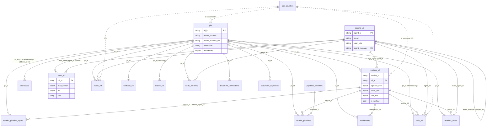

# rlm-backend-nest database

Last verified: 2026-10-07 @ 278fe58 (kartik)

## Connection
- One MongoDB connection (Mongoose default connection) in `src/database/database.module.ts` (@Global); raw access via
  `src/common/raw-db/raw-db.service.ts` (`connection.db.collection(name)` + wrappers + `incrementCounter`).
- Env var NAMES: `MONGODB_URI` (required), `MONGODB_DB_NAME`. DB name resolution: `MONGODB_DB_NAME` -> path of the URI
  -> default `CRM-Database`. Explicit `dbName` fixes the old `//CRM-Database` leading-slash namespace bug.
- Pool: `maxPoolSize 20` per worker (2 workers -> up to 40 per host), `waitQueueTimeoutMS 40000`,
  `serverSelectionTimeoutMS 10000`, `socketTimeoutMS 45000`.
- No global readPreference / writeConcern. Only `common/orders-v2/orders-legacy-fallback.service.ts` uses
  `secondaryPreferred` (+ allowDiskUse) on one aggregate.
- Environments: only `NODE_ENV` (development | production | test). No staging DB split in code; the environment is
  whatever URI the host `.env` gives. Scripts and app all target `CRM-Database`. A seed-script comment says the
  app's default URI is read-only: UNVERIFIED (the app writes).
- DNS: `src/common/boot/dns.ts` sets public resolvers for `mongodb+srv` SRV lookups (`DNS_SERVERS=system` to disable).

## Migrations
- No migration framework. Schema changes are code-only (Mongoose) plus one-off scripts.
- `scripts/db/DB-01..DB-45-*.mjs` (data quality and index tasks: piis Aadhaar protection, orders_v2 fixes, pincode /
  district cleanup, agents_v2 cleanup, hidden/redundant/duplicate indexes). **Dry-run by default.** Apply with
  `--apply --confirm=CRM-Database` (optionally `--limit=N`). Before/after JSON undo logs land in `scripts/db/out/`.
  Run: `MONGODB_URI=<uri> MONGODB_DB_NAME=CRM-Database node scripts/db/DB-NN-<name>.mjs [--apply --confirm=CRM-Database]`.
  `scripts/db/run-all-dry.mjs` runs all dry. Runbook: `docs/db-tasks-runbook.md`.
- `scripts/perf/*` (index-usage, note-id-index, phone-number-rev, postcode-field): same dry/apply rules.
- Seeds: `scripts/seed-{fo,ro,ar,lr}-pipeline-workflow.ts` upsert `pipelines_workflow` (`npx ts-node ...`, write-capable URI).

## Indexes
- `autoIndex` is ON globally (schema `.index()` built by Mongoose). Exceptions with `autoIndex:false`: `addresses`, `orders_v2`.
- Boot index builds: many services call `createIndex` in `onModuleInit` fire-and-forget (skipped when
  `NODE_ENV=development`) because awaiting them delayed `listen()` and Render failed with "No open ports detected".
  Seen in retailers, rps, retailer-events, requested-carts, product-category, product-visibility, lead-ownership.
- Admin HTTP: `GET/POST /api/v2/db/indexes` (ops/db-indexes): list with `$indexStats`, build with pre-flight checks,
  `background:true`, `dry_run`. Public + MaintenanceGuard (admin token or maintenance secret).
- Scripts: `scripts/db` DB-29..DB-44 (index stats, hidden/redundant/duplicate), DB-33 (orders_v2 indexes), `scripts/perf`.
- Unique gaps: `retailers_v2.retailer_id` indexed but NOT unique (`retailers/duplicate-ids` repairs then builds `retailer_id_unique`).

## ER diagram (pii_id hub; string FKs, no ObjectId refs except a few `ref:` props)

Cardinalities are inferred from code usage, not enforced: piis->contacts_v2 (0..1) and piis->leads_v2 (many, "latest
lead" used) are UNVERIFIED. `orders_v2` -> `status`/`status_v2` via status ids. Legacy `orders`, `calls`, `retailers`
mirror the old (pre-v2) shapes and join on `pii_id`/phone (UNVERIFIED in detail); they are not drawn.

## Collection ownership (W = writes, R = reads; "raw" = no Mongoose schema)
| Collection | Writers | Readers |
|---|---|---|
| piis | retailers-core, verification-kyc (pii, addresses) | almost every domain (access, phone-search, netcore, leaderboard...) |
| retailers_v2 | retailers-core, verification-kyc, pipeline, calls, notes (remarks), analytics (rps sync, call-outcome) | most domains, common/access, lqs-score |
| addresses | verification-kyc (addresses), retailers-core (create) | pii, retailer-events, analytics, address-values |
| leads_v2 (raw) | lead-assignment, verification (is_kyc, profile), retailers-core (role mirror, app_version) | lead-ownership, lqs-score, agents, notifications, alerts, analytics, netcore, files |
| agents_v2 | agents | auth, access, nearly everyone (names, hierarchy), portal-data/queries |
| notes_v2 | notes (+ verification audit notes) | retailers-core, analytics, access |
| calls_v2 | calls | agents, pipeline, analytics, lead-assignment, retailers-core |
| contacts_v2 | verification, retailers-core (profile) | retailer-events, rps |
| orders_v2 | **Stockship** (external); repair cascade only | orders, analytics, pipeline, agents, lead-assignment, retailers-core via common/orders-v2 |
| retailevents | retailer-events, analytics (`rps-event`) | pipeline, analytics, retailers-core, access |
| retailers_alerts | retailer-alerts | access (indirect) |
| retailer_pipelines, pipelines_workflow | pipeline (+ seed scripts for workflow) | pipeline, retailers-core |
| retailer_pipeline_cycles | retailers-core | pipeline, analytics, access |
| document_verifications, document_rejections | verification-kyc (+ retailer PATCH via services) | verification-kyc |
| carts_requests, carts (raw) | orders-commerce (requested-carts) | requested-carts, access |
| app_counters (raw) | retailers-core, notes, calls, addresses, agents, bug-reports | same |
| job_locks (raw) | retailers-core (order-info-recompute) | same |
| log_foro | lead-assignment, retailers-core (upsert failure trace) | - |
| lead_owner_history, rr_state_pointer, rr_skip_condition_log, fo_assign_skip_log, foro_reports, buckets_v2 (raw) | lead-assignment (buckets_v2 R only) | lead-assignment |
| lost_feedback, retailer_groups, retailer_group_logs | analytics (retailer-admin) | analytics |
| salesscenarios | analytics (sales-potential) | analytics |
| retailer_leaderboard (raw) | external nightly job (UNVERIFIED) | analytics (leaderboard) |
| bug_reports_v2, bug_messages_v2 | ops (bug-reports) | ops |
| retailer_farmers, retailer_inventory, retailer_inventory_sales, retailer_profits | retailer-app | retailer-app |
| products, cases, combos (raw) | products (category, visibility) | orders, analytics, retailer-events, return-refunds |
| categories, subcategories, bulks (R only), products_v2, combos_v2 (raw) | - (Stockship catalogue, UNVERIFIED owner) | products, orders, return-refunds, analytics |
| product_category_update_logs (raw), cases_updation_logs | products | products |
| status, status_v2 (raw) | - (master) | common/order-status, orders-v2, orders, pipeline, retailers-core |
| return_refunds, bankinfos (raw) | - | orders-commerce (return-refunds) |
| states_v2, districts_v2, pincode_map_v2 (raw) | - (masters) | analytics, leaderboard, addresses (pincode check) |
| dynamicdatas (raw) | - | retailer-events (CH-sync threshold) |
| orders (legacy, raw) | - | common/orders-v2 fallback, orders, lead-assignment, return-refunds, rps |
| calls (legacy, raw) | - | lead-assignment |
| retailers (legacy, raw) | legacy-update, retailers-core (is_verified mirror), repair cascade | db-indexes |
| alerts (legacy?, raw) | retailers-core (insert on document update) | UNVERIFIED |
| skp_owners (raw) | retailers-core repair cascade (UNVERIFIED per run) | db-indexes |
| any collection | ops (db-indexes) | ops (db-indexes) |

## Data access pattern
- Mongoose models (28 schemas, `forFeature` per module; Agent/Pii/Retailer re-registered in several modules) for owned
  collections; `RawDbService` for everything schema-less (used in 71 files across ~27 modules).
- **No transactions** (`startSession`/`withTransaction` absent). PII + retailer + address fan-out and denormalised
  caches (`retailers_v2.call_info`, `remarks`, `has_address`, `order_info`) are separate writes.
- Fail-soft secondary writes: Firestore mirror, Netcore, Slack, sockets, CH-sync, legacy mirror never roll back Mongo.
- In-memory per-worker caches (see architecture.md). Heavy reads are gated (`common/utils/gate.ts`).
- Perf concerns (`docs/slow-requests.md`, NEST-21): `GET /retailer-admin/rps-dashboard` (LQS snapshot: distinct
  `pii_id` on retailers_v2 + chunked leads_v2), `GET /retailer-admin/distinct-wise` ($group over verified retailers),
  `GET /retailer-admin/agent-with-leads` (agents -> leads -> retailers + 3 orders_v2 aggregates). Phone search uses
  `phone_number_rev` (a phone regex caused the 02 Sep outage). Slow-request threshold `SLOW_REQUEST_LOG_MS`.

## Schema conventions
- Human-readable string ids from `app_counters` (`$inc` upsert): `PI-n` (piis), `KP-n` (retailers), `ADDR-...`
  (addresses), `NT-n` (notes), `CL-n` (calls), `AG-xxxxx` (agents; legacy `A0-nnnn`), `BR-...` (bugs). Lead ids `LD-...`.
  `app_counters` drifts (retailers counter far below the max KP id); `allocateId` checks data and retries up to 25.
- `*_v2` = current data model. Un-suffixed `orders`, `calls`, `retailers` are legacy: read for fallback/compat
  (`ORDERS_LEGACY_FALLBACK_DISABLED`), `retailers` still written by legacy-update and the is_verified mirror.
- `orders_v2`: `strict:false`, `autoIndex:false`, written by Stockship; nest maps it to legacy status ids/shape.
  Filter on `date` (not `created_at` = migration time). Cancelled statuses [10,12,13]; delivered = 15.
- `addresses`: `is_active` absent on most legacy docs; query `is_active: {$ne:false}`. Legacy line/postcode fields coexist.
- `document_verifications`: TTL index on `expire_at` (failed/pending kept ~90 days, verified kept forever).
- Timestamps mostly `created_at`/`updated_at` (some `createdAt`). Owner/kyc agent derived from `leads_v2`.

## Supabase (`src/common/supabase/supabase-rest.service.ts`; axios -> PostgREST `/rest/v1`, Storage `/storage/v1`, 15 s)
- `crm` "Sales CRM" (`SUPABASE_URL`, `SUPABASE_SERVICE_KEY`; blank -> `/portal` 503). Tables by module:
  portal-data: notifications, motivational_quotes, products, training_videos, forum_questions(+_comments,_attachments),
  agents, rps_tasks, retailers, bandwidth_settings, agent_test_sessions, sops, processes, sop_categories ·
  portal-agents: agents, agent_levels, daily_agent_metrics, agent_coin_transactions, calls, kyc_audit_scores,
  grievances, activity_logs, whatsapp_conversations · portal-certificates: certificate_templates, issued_certificates ·
  portal-drafts: verification_draft_info · portal-grievances: grievances, grievance_timeline · portal-ideas: ideas,
  idea_comments, idea_votes, idea_notifications · portal-misc: voice_issue_reports, app_events, messages ·
  portal-onboarding: onboarding_batches, onboarding_batch_agents, onboarding_sessions, onboarding_session_attendance,
  onboarding_audit_log · portal-queries: query_master, query_usage_logs, lead_queries · portal-retail: retailers,
  orders, rps_tasks, ivr_calls, products, training_videos, agents · portal-targets: monthly_targets, tenure_targets,
  agent_target_overrides, target_change_logs. Buckets: `forum-attachments`, `test_recordings` (missing).
- `m360` "Marketing 360" (`MARKETING_SUPABASE_URL`, `MARKETING_SUPABASE_SERVICE_KEY`/`_KEY`): rlm_portal_sops, states, districts (R).
- CH-sync staging (Stockship-owned; `CH_SYNC_SUPABASE_URL`, `CH_SYNC_SUPABASE_SERVICE_ROLE_KEY`): insert into
  `public.retailer_events`, then Stockship flushes to ClickHouse (`STOCKSHIP_V3_BASE_URL`, `CRON_X_API_KEY`).
- Bug-report attachments are uploaded client-side; backend only validates the URL host. SQL/RLS work:
  `scripts/supabase/`, runbook `docs/supabase-tasks-runbook.md`.

## Firebase (`src/common/firebase`, FirebaseService, fail-soft when unconfigured)
- Firestore: `Retailer Users` (doc id `+91<phone>`; app-user mirror, `APP_USER_MIRROR`), subcollection
  `Cart Items/Requested Items`, `Retailer Dynamic Section V2/distributor`, `Retailer Pesticide Certificate`.
- RTDB (separate project, `FIREBASE_DATABASE_URL`, optional `FIREBASE_RTDB_*` creds): `calls/{uuid}`, `agents/{topic}`.
- Storage (`FIREBASE_STORAGE_BUCKET`): `POST /files` uploads (`retailers/...`, `pc-requests/...`); KYC V4 signed URLs
  (`KYC_SIGNED_URLS`, `KYC_SIGNED_URL_BUCKETS`). FCM not used.
