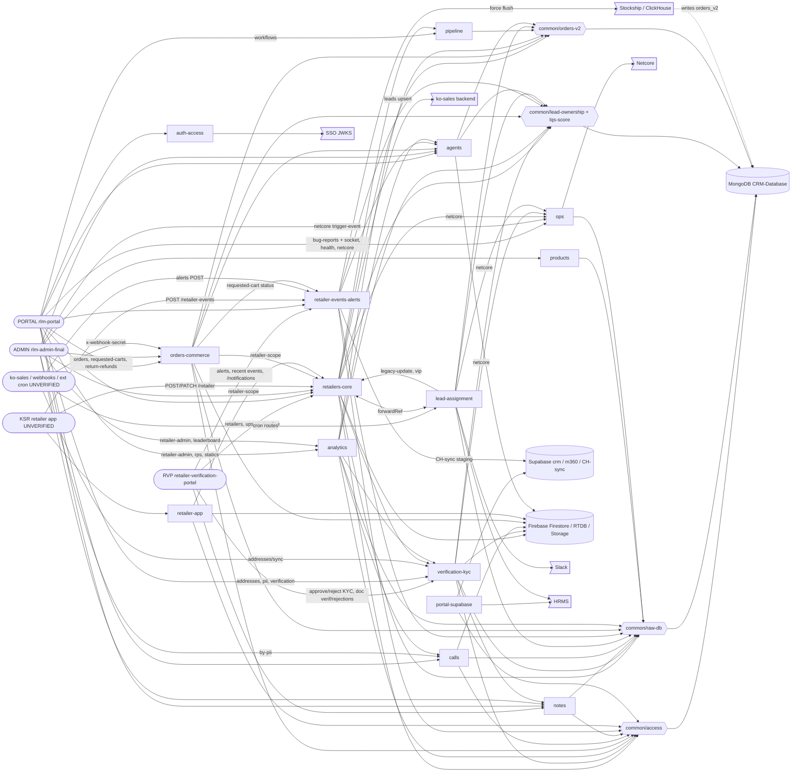

# rlm-backend-nest module graph
Last verified: 2026-10-07 @ 278fe58 (kartik)

Domains group the 52 folders under `src/modules/` (see `modules/<domain>.md`). Edges = module imports / service
injection (solid) and HTTP/socket calls from frontends (left). FE edges come from a static scan of the 3 FE repos
on their checked-out branches (RVP `claude-memory-setup`, PORTAL `kartik`, ADMIN `kartik`).

| Module (domain) | Nest modules inside | Depends on | Used by (modules + FEs) | Collections touched |
|---|---|---|---|---|
| auth-access | auth, common/access, common/guards | SSO, agents_v2 | every module; PORTAL (`/auth/*`) | agents_v2 (R) |
| retailers-core | retailers (+pipeline-cycles, duplicate-ids, reconcile, crons, vip), retailer, retailer-scope, legacy-update, contacts (schema) | verification-kyc, pipeline, lead-assignment, ops/netcore, access, ownership, orders-v2, Firebase, ko-sales | lead-assignment, orders-commerce, retailer-app; RVP, PORTAL, ADMIN, KSR (UNVERIFIED) | retailers_v2, piis, addresses, leads_v2, retailer_pipeline_cycles, log_foro, app_counters, job_locks, retailers (legacy), alerts, contacts_v2, + repair cascade |
| verification-kyc | verification, document-verifications, document-rejections, pii, addresses | notes, ops/netcore, Firebase | retailers-core, analytics; RVP, PORTAL | piis, addresses, retailers_v2, leads_v2, contacts_v2, notes_v2, document_verifications, document_rejections, pincode_map_v2, app_counters |
| pipeline | pipeline | orders-v2, retailers utils | retailers-core; PORTAL | retailer_pipelines, pipelines_workflow, retailers_v2, calls_v2, retailevents, status |
| lead-assignment | lead-assignment, slack | ops/netcore, retailers-core (legacy-update, vip, forwardRef), Slack, HRMS | retailers-core; external cron (UNVERIFIED) | leads_v2, lead_owner_history, rr_state_pointer, rr_skip_condition_log, fo_assign_skip_log, foro_reports, log_foro, buckets_v2, orders(_v2), calls(_v2) |
| retailer-events-alerts | retailer-events, retailer-alerts, notifications | agents, auth, Supabase CH-sync, Stockship | orders-commerce (requested-carts); RVP, PORTAL, KSR (UNVERIFIED), ko-sales | retailevents, retailers_alerts, dynamicdatas, leads_v2 (R) |
| notes | notes | raw-db | verification-kyc; RVP, PORTAL, ADMIN | notes_v2, retailers_v2.remarks, app_counters |
| calls | calls | auth, Firebase RTDB | agents, analytics; PORTAL, ADMIN | calls_v2, retailers_v2.call_info, app_counters |
| orders-commerce | orders, return-refunds, requested-carts, pc-requests | agents, notifications, retailer-scope, orders-v2, Firebase | PORTAL, ADMIN, ko-sales (requested-carts) | orders_v2 (R), orders (R), status, carts_requests, carts, return_refunds, bankinfos, products/combos (R) |
| analytics | retailer-admin, rps, statics, sales-potential, leaderboard | verification, agents, calls, orders-v2, ownership | PORTAL, ADMIN | retailers_v2, leads_v2, lost_feedback, retailer_groups(_logs), salesscenarios, retailer_leaderboard, geo masters (R) |
| agents | agents, app-users | auth, orders-v2, ownership, Firestore | orders, analytics, events; PORTAL, ADMIN | agents_v2, app_counters, calls_v2/leads_v2/piis (R) |
| products | product-category, product-visibility | raw-db | ADMIN | products, cases, combos, categories, subcategories, bulks (R), product_category_update_logs, cases_updation_logs |
| retailer-app | farmers, inventory, profit-calculator, files | retailer-scope, Firebase Storage | KSR app (UNVERIFIED) | retailer_farmers, retailer_inventory, retailer_inventory_sales, retailer_profits, leads_v2 (R) |
| portal-supabase | portal-data + 10 portal-* | Supabase crm/m360, HRMS, access | no FE on current branches (RVP/PORTAL migration branches) | agents_v2 (R) only; ~45 Supabase tables |
| ops | health, logs, db-indexes, bug-reports, netcore | auth, Netcore, Supabase (URL check) | lead-assignment, retailers-core, kyc (netcore); PORTAL, ADMIN | bug_reports_v2, bug_messages_v2, app_counters, any (db-indexes) |
