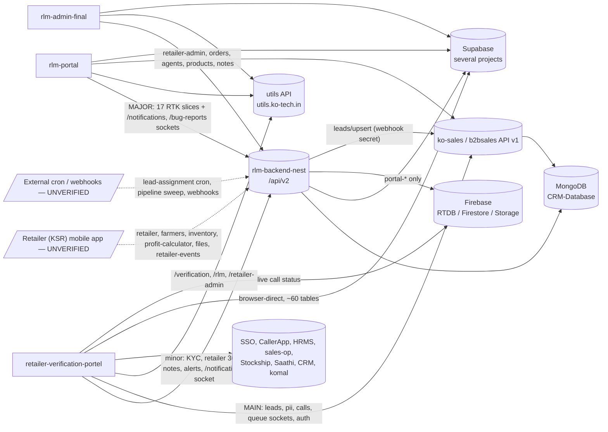

# RLM system map (cross-project)

Last verified: 2026-10-07. Backend `rlm-backend-nest` @ 278fe58 (kartik). FEs: retailer-verification-portel @ 6e2113d (kartik),
rlm-portal (kartik), rlm-admin-final (kartik). The rlm-portal and rlm-admin-final rows come from a read-only consumer survey;
those projects have no memory directory yet.

Edit this file IN PLACE whenever a frontend starts or stops calling a backend route, or a backend adds or removes a module.

## Who talks to whom

Dashed edges = consumer inferred from the module's purpose, not found in any FE repo (UNVERIFIED).

## How each frontend reaches rlm-backend-nest

| Frontend | Base URL env var NAMES | Client code | Sockets used |
|---|---|---|---|
| retailer-verification-portel | `VITE_NEST_V2_URL` (value includes `/api/v2`), `VITE_NEST_V2_NOTIFICATION_SOCKET_URL` | `src/services/backendApi.ts` `fetchNestV2()`, `src/redux/api/kycModuleApi.ts` (absolute NEST URLs only), `src/components/profiled/{useProfiledLead,documentVerifications}.ts`, `src/hooks/useRetailerAlerts.ts` | `/notifications` (`src/hooks/useEventNotificationSocket.ts`) |
| rlm-portal | `VITE_V2_API_URL` + `VITE_V2_API_PREFIX` | `src/redux_v2/apis/base_api.service.ts` + 17 slices; direct fetch in `src/lib/salesCartApi.ts`, `src/hooks/useTeamBandwidth.ts`, `src/redux/api/contactsSlice.ts` | `/notifications`, `/bug-reports` |
| rlm-admin-final | `VITE_NEST_BASE_URL` + `VITE_NEST_API_PREFIX` | `src/redux/*.v2.api.ts`, `src/redux/netcore.api.ts` | none |

## Backend domain → consumers

Domain names match `rlm-backend-nest/modules/*.md`.

| Backend domain | RVP | PORTAL | ADMIN | Other (UNVERIFIED) |
|---|---|---|---|---|
| retailers-core (`/retailers*`) | ✓ list, detail, upsert, lead/update, timeline, audit-history | ✓ | ✓ | KSR app (`/retailer`), webhooks |
| verification-kyc (`/verification`, `/document-*`, `/pii`, `/addresses`) | ✓ approve/reject, document-rejections, document-verifications | ✓ approve/reject, lead-lost, pii, addresses | — | KSR app |
| notes | ✓ | ✓ | ✓ by-pii | — |
| retailer-events-alerts | ✓ events/recent, retailer-alerts, `/notifications` socket | ✓ events, `/notifications` socket | — | KSR app POSTs events; ko-sales POSTs alerts |
| analytics (`/retailer-admin`, `/rps`, `/statics`, `/sales-potential`, `/leaderboard`) | — (RVP calls same-named routes on **utils**, not nest) | ✓ | ✓ (leaderboard via hard-coded onrender host) | — |
| orders-commerce (`/orders`, `/requested-carts`, `/return-refunds`, `/pc-requests`) | — | ✓ | ✓ orders | — |
| calls | — (uses Firebase RTDB directly) | ✓ | ✓ by-pii | — |
| agents | — | ✓ | ✓ | — |
| pipeline | — | ✓ workflows | — | — |
| products | — | — | ✓ | — |
| auth-access (`/auth`) | — | ✓ | — | — |
| ops (`/health`, `/bug-reports`, `/netcore`, `/logs`, `/db/indexes`) | — | ✓ health, bug-reports, netcore | ✓ netcore | ops tooling |
| lead-assignment | — | — | — | external cron |
| retailer-app (`/farmers`, `/inventory`, `/profit-calculator`, `/files`) | — | — | — | KSR app |
| portal-supabase (`/portal/*`) | — on current branch; unmerged `origin/migration`, `origin/query-event-opt` move RVP Supabase calls here | — on current branch; same unmerged branches | — | — |

## Known cross-project mismatches

- ADMIN calls `GET /geography/crops*`, but no geography module exists on the backend's current branch. It exists only on unmerged
  backend branch `origin/feat/orders-foro-status-breakdown`. Expect a 404 in prod until that branch is deployed.
- ADMIN leaderboard calls a hard-coded `retailer-v2-backend.onrender.com` host instead of `VITE_NEST_BASE_URL`.
- RVP and ADMIN call `/retailer-admin/*`, `/verification/*` and `/sales-potential/*` on the **utils** API. The backend has
  same-named routes (it is a port of utils), so check the base URL before assuming which server answers.
- Notes exist in two systems: ko-sales `/notes` (RVP KYCWorking) and nest `/notes` (RVP Profiled, KYCModule, CallWidget).
- Production CORS origins (`CORS_ORIGIN`) live only in the backend host `.env`, so the allowed FE origins are UNVERIFIED.

## Production branches (never push directly)

| Repo | Prod branch | Deploy |
|---|---|---|
| retailer-verification-portel | `aws-v4` | GitHub Actions → S3 + CloudFront |
| rlm-backend-nest | `aws-deployed` | GitHub Actions → EC2 (fallback host only today; see project AGENTS.md) |
| rlm-portal | UNVERIFIED | — |
| rlm-admin-final | UNVERIFIED | — |
